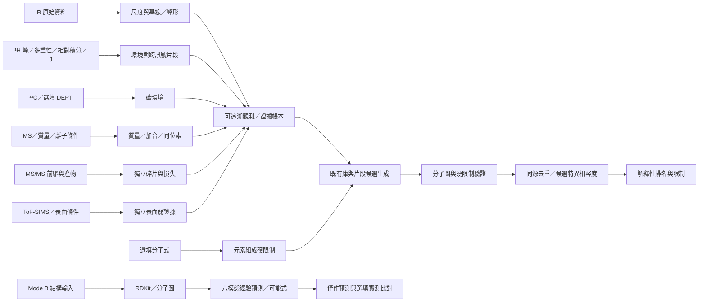

# V0 功能保留與 V1 資料流

V0 來源逐檔比較見 `validation/v0-v1-file-comparison.json`；沒有刪除既有 src 功能檔。obsolete bun.lock 留本機但不列正式依賴入口，使用唯一 pnpm lockfile。

|功能|正式入口／模組|本輪驗證|
|---|---|---|
|桌面／雙模式／三頁流程|`App.tsx`、四個既有 component|桌面 E2E；只加必要六模態預測選項與科學文字|
|上傳／CSV／TXT／Excel／JCAMP|`SpectrumParser.parseUploadedFile`／parseTextSpectrum／parseExcelSpectrum|原格式保留、精度／實際 xlsx／JCAMP 回歸|
|原始圖片／讀譜／人工標峰|`SpectrumViewer.tsx`、SpectrumParser 圖像校正與 App handlers|人工標峰 E2E；AI 圖像自動辨識無 Key 未驗收|
|峰值校正／人工覆核|App 第 1／2 頁、SpectrumParser 校正 API|原圖與快照保留；未校正像素不進入科學證據|
|IR／¹H／¹³C／MS|`ChemicalFeatureEngine.extractIntegratedConstraints` 呼叫既有引擎與物理模組|六模態獨立正式管線／無式、63 組合|
|MS/MS／ToF-SIMS|extraInput／平行來源 → 獨立科學引擎|與一般 MS 分開，不要求先上傳 MS|
|分子式／元素／DBE|化學硬限制／FormulaGenerator|選填；分子式單獨只提供組成限制，質量不是實測|
|分子圖／官能基／化學環境|RDKit adapter → 內建圖環境 → NMR／IR predictors|等價 SMILES／非法價態／正負離子／SMARTS|
|候選生成／排名|CandidateGenerator.executeUnifiedPipelineFromBundle → graph validator → crossSpectrumValidator／evidenceLedger|最終分數可重建，非只加入新診斷模組|
|Mode B 六模態|WorkbenchOrchestrator → PredictionAndValidationFramework／ReasoningEngine|十二結構與六單模態預測，不污染 Mode A|
|後端／PubChem／AI|`server.ts` 原 API|health／status／錯誤／大小／速率與逾時；外部服務不是本地科學前置條件|

所有來源平行且選填，沒有 IR→NMR→MS 的前置依賴；缺少光譜不產生陰性分數。證據不足不能唯一確定結構，有限候選集合與經驗模型的限制必须隨結果保留。
